# 03 — Data Model

PostgreSQL 17 + pgvector. All schema changes go through Flyway (`backend/src/main/resources/db/migration`).

## Conventions
- **Primary keys:** `uuid`, time-ordered (UUIDv7), generated by the application. Ids are not guessable and sort well in B-tree indexes.
- **Tenant column:** every tenant-owned table has `org_id uuid NOT NULL`. Child tables use **composite foreign keys** such as `(project_id, org_id) REFERENCES project(id, org_id)`, so the database rejects rows that mix tenants.
- **Concurrency:** mutable aggregates have `version bigint` (JPA `@Version`).
- **Timestamps:** `timestamptz`, stored in UTC. Due dates are `date` and are interpreted in the organization's time zone.
- **Soft delete:** `deleted_at` on tasks, comments and documents. Partial indexes `WHERE deleted_at IS NULL` keep queries fast.
- **Enums:** stored as `text` with `CHECK` constraints. Adding a value needs a migration, but this avoids the awkwardness of altering native Postgres enums.

## ER diagram

```mermaid
erDiagram
  APP_USER ||--o{ REFRESH_TOKEN : has
  APP_USER ||--o{ ORGANIZATION_MEMBERSHIP : "member of"
  ORGANIZATION ||--o{ ORGANIZATION_MEMBERSHIP : has
  ORGANIZATION ||--o{ INVITATION : issues
  ORGANIZATION ||--o{ PROJECT : owns
  PROJECT ||--o{ PROJECT_MEMBER : has
  APP_USER ||--o{ PROJECT_MEMBER : "assigned to"
  PROJECT ||--o{ MILESTONE : has
  PROJECT ||--o{ TASK : has
  MILESTONE |o--o{ TASK : groups
  APP_USER |o--o{ TASK : "assignee"
  TASK ||--o{ TASK_DEPENDENCY : "blocked by"
  TASK ||--o{ TASK_COMMENT : has
  PROJECT ||--o{ ACTIVITY_EVENT : records
  PROJECT ||--o{ PROJECT_METRIC_SNAPSHOT : "daily metrics"
  PROJECT ||--o{ DOCUMENT : stores
  DOCUMENT ||--o{ DOCUMENT_CHUNK : "split into"
  DOCUMENT ||--o| INGESTION_JOB : "processed by"
  PROJECT ||--o{ AI_CONVERSATION : about
  APP_USER ||--o{ AI_CONVERSATION : owns
  AI_CONVERSATION ||--o{ AI_MESSAGE : contains
  AI_MESSAGE ||--o{ AI_TOOL_INVOCATION : triggered
  APP_USER ||--o{ NOTIFICATION : receives
  ORGANIZATION ||--o{ AUDIT_LOG : "audit trail"

  APP_USER {
    uuid id PK
    varchar email UK "stored lower-cased"
    text password_hash
    text display_name
    text status "ACTIVE|DISABLED"
    timestamptz created_at
  }
  REFRESH_TOKEN {
    uuid id PK
    uuid user_id FK
    bytea token_hash UK
    uuid family_id
    timestamptz expires_at
    timestamptz revoked_at
    uuid replaced_by_id
  }
  ORGANIZATION {
    uuid id PK
    text name
    text slug UK
    text time_zone
    bigint version
  }
  ORGANIZATION_MEMBERSHIP {
    uuid id PK
    uuid org_id FK
    uuid user_id FK
    text role "OWNER|ADMIN|PROJECT_MANAGER|MEMBER"
    timestamptz joined_at
  }
  INVITATION {
    uuid id PK
    uuid org_id FK
    varchar email "stored lower-cased"
    text role
    bytea token_hash UK
    uuid invited_by FK
    timestamptz expires_at
    timestamptz accepted_at
    timestamptz revoked_at
  }
  PROJECT {
    uuid id PK
    uuid org_id FK
    text key "unique per org"
    text name
    text description
    text status
    date start_date
    date target_date
    uuid owner_id FK
    int next_task_number
    bigint version
  }
  PROJECT_MEMBER {
    uuid project_id PK
    uuid user_id PK
    uuid org_id FK
    text role "MANAGER|CONTRIBUTOR|VIEWER"
    int weekly_capacity_points
  }
  MILESTONE {
    uuid id PK
    uuid org_id FK
    uuid project_id FK
    int number "M-n"
    text name
    date due_date
    text status "OPEN|COMPLETED"
    bigint version
  }
  TASK {
    uuid id PK
    uuid org_id FK
    uuid project_id FK
    int number "KEY-n"
    text title
    text description
    text status
    text priority "LOW|MEDIUM|HIGH|CRITICAL"
    uuid assignee_id FK
    uuid reporter_id FK
    uuid milestone_id FK
    date due_date
    int estimate_points
    timestamptz started_at
    timestamptz completed_at
    timestamptz deleted_at
    bigint version
  }
  TASK_DEPENDENCY {
    uuid task_id PK
    uuid depends_on_task_id PK
    uuid org_id FK
    uuid project_id FK
  }
  TASK_COMMENT {
    uuid id PK
    uuid org_id FK
    uuid task_id FK
    uuid author_id FK
    text body
    timestamptz edited_at
    timestamptz deleted_at
  }
  ACTIVITY_EVENT {
    uuid id PK
    uuid org_id FK
    uuid project_id FK
    uuid actor_id FK
    text entity_type
    uuid entity_id
    text action
    jsonb details
    timestamptz occurred_at
  }
  PROJECT_METRIC_SNAPSHOT {
    uuid project_id PK
    date snapshot_date PK
    uuid org_id FK
    int total_tasks
    int done_tasks
    int overdue_tasks
    int blocked_tasks
    int health_score
  }
  DOCUMENT {
    uuid id PK
    uuid org_id FK
    uuid project_id FK
    text filename
    bigint size_bytes
    bytea sha256
    text storage_key
    text status "PENDING|PROCESSING|READY|FAILED"
    text error_message
    int page_count
    uuid uploaded_by FK
    timestamptz deleted_at
  }
  DOCUMENT_CHUNK {
    uuid id PK
    uuid org_id FK
    uuid project_id FK
    uuid document_id FK
    int chunk_index
    int page_from
    int page_to
    text section_title
    text content
    int token_count
    vector embedding "vector(768), nomic-embed-text"
    text embedding_model
  }
  INGESTION_JOB {
    uuid id PK
    uuid document_id FK
    text status
    int attempts
    timestamptz next_run_at
    timestamptz locked_until
    text locked_by
    text last_error
  }
  AI_CONVERSATION {
    uuid id PK
    uuid org_id FK
    uuid project_id FK
    uuid user_id FK
    text title
    timestamptz created_at
  }
  AI_MESSAGE {
    uuid id PK
    uuid org_id FK
    uuid conversation_id FK
    text role "USER|ASSISTANT"
    text content
    jsonb structured_response
    text status "OK|INVALID_OUTPUT|TIMEOUT|REJECTED|ERROR"
    text model
    int prompt_tokens
    int completion_tokens
    int latency_ms
    jsonb verification "unverified refs etc."
  }
  AI_TOOL_INVOCATION {
    uuid id PK
    uuid org_id FK
    uuid message_id FK
    text tool_name
    jsonb arguments
    jsonb returned_refs
    boolean authorized
    int duration_ms
  }
  NOTIFICATION {
    uuid id PK
    uuid org_id FK
    uuid recipient_id FK
    text type
    jsonb payload
    timestamptz read_at
  }
  AUDIT_LOG {
    bigint id PK
    uuid org_id "nullable (e.g. login)"
    uuid actor_id
    text action
    text target_type
    uuid target_id
    inet ip
    text outcome "SUCCESS|DENIED|FAILURE"
    jsonb details
    timestamptz occurred_at
  }
```

Infrastructure tables (not shown): `flyway_schema_history`, `login_attempt` (failed-login counters), `event_publication` (Spring Modulith outbox), `shedlock`, `bucket` (Bucket4j, AI quotas).

**Email case-insensitivity:** emails are trimmed and lower-cased by the application before they are stored or looked up, and a `CHECK (email = lower(btrim(email)))` constraint enforces it, so the plain unique constraint is case-insensitive. This replaced the earlier `citext` plan: it keeps the column a normal `varchar` that JPA maps and indexes without special handling.

## Key constraints and indexes

| Table | Constraint / index | Purpose |
|---|---|---|
| organization_membership | `UNIQUE (org_id, user_id)`; index `(user_id)` | Membership lookup on every request |
| project | `UNIQUE (org_id, key)`; `UNIQUE (id, org_id)` | Composite-FK target |
| task | `UNIQUE (project_id, number)`; FK `(project_id, org_id) → project(id, org_id)` | Human keys, tenant consistency |
| task | `(project_id, status) WHERE deleted_at IS NULL` | Board and list queries |
| task | `(project_id, due_date) WHERE deleted_at IS NULL AND status NOT IN ('DONE','CANCELLED')` | Overdue query |
| task | `(assignee_id) WHERE deleted_at IS NULL` | Workload |
| task_dependency | `CHECK (task_id <> depends_on_task_id)`; index `(depends_on_task_id)` | Self-loops rejected in the DB; longer cycles rejected in the service |
| activity_event | `(project_id, occurred_at DESC)` | Feed, "recent activity" tool |
| document | `UNIQUE (project_id, sha256) WHERE deleted_at IS NULL` | Duplicate detection |
| document_chunk | HNSW on `embedding vector_cosine_ops`; btree `(project_id)`; FK `document_id ON DELETE CASCADE` | Filtered similarity search |
| ingestion_job | `(status, next_run_at)` | `SKIP LOCKED` polling |
| refresh_token | `UNIQUE (token_hash)`; `(family_id)` | Rotation and reuse detection |
| audit_log | `(org_id, occurred_at DESC)`; append-only (app DB role has no UPDATE/DELETE grant) | Tamper resistance |

### Derived, not stored
- **Blocked:** the task is open and `EXISTS` a dependency whose task is not `DONE`/`CANCELLED`. It is computed in queries, so it can never drift out of date.
- **Overdue:** computed from `due_date`, `status` and the org's local date.
- **Health score:** computed on read, and persisted only as a daily snapshot for trends.

### Note on filtered vector search
HNSW plus a selective `WHERE project_id = ?` can return fewer than *k* rows because the filter runs after the index scan. pgvector ≥ 0.8 supports **iterative index scans** (`SET hnsw.iterative_scan = relaxed_order`), which fix this. We enable that setting per query and cover the case with a retrieval test.
